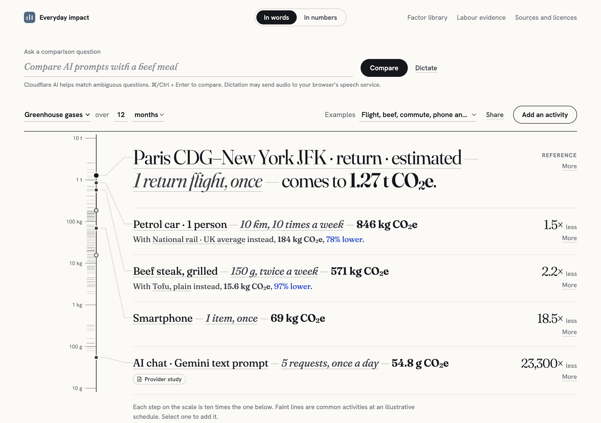
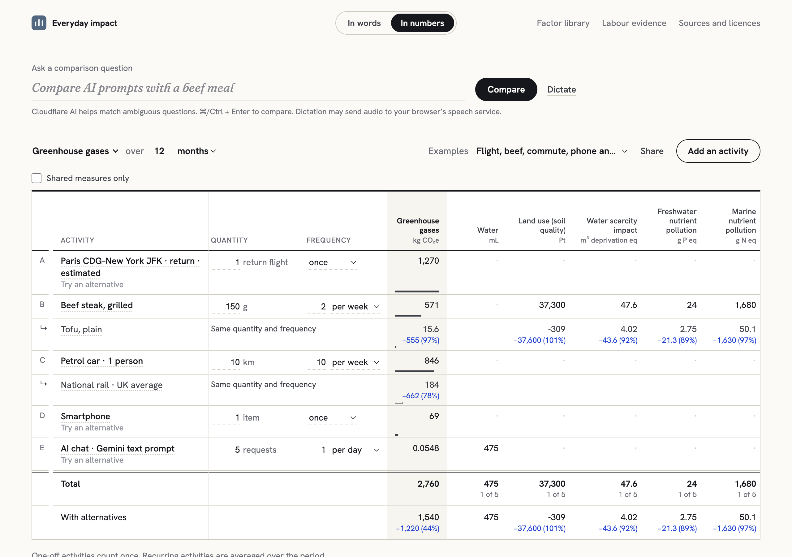
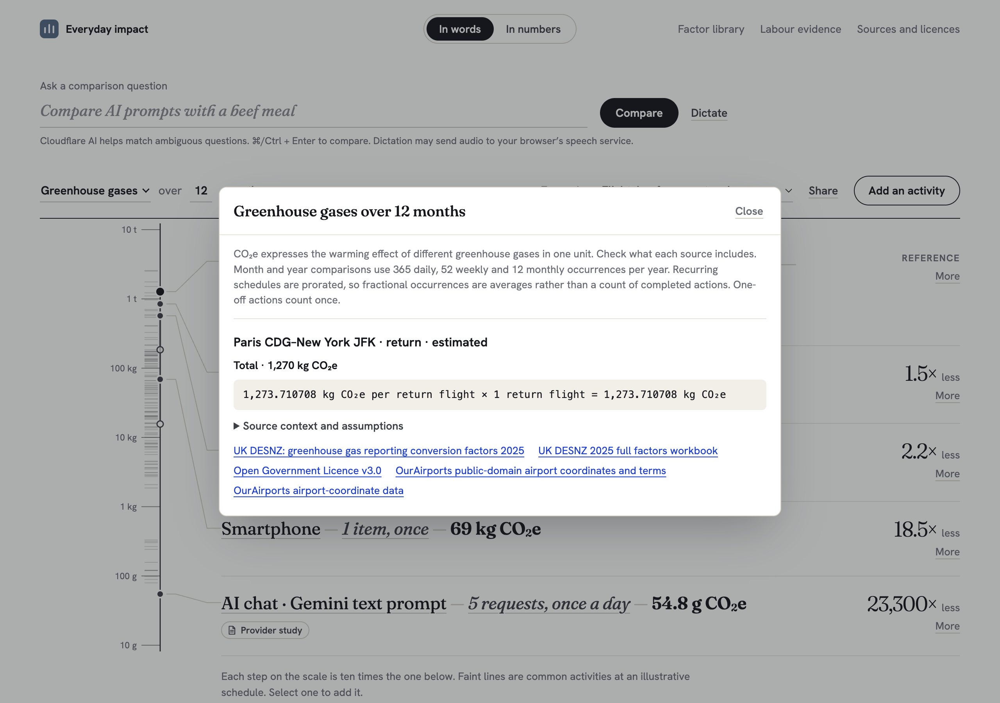

<div align="center">


# Everyday impact

Compare the footprint of everyday actions and lifestyle changes, and inspect the evidence behind each estimate.

<a href="https://everyday-impact.pages.dev/"></a>

</div>

<a href="https://everyday-impact.pages.dev/"></a>

## What it does

- **In words** writes one sentence per activity, ranked beside a scale where each step is ten times the one below.
- **In numbers** shows every measure as a column, with alternatives as sub-rows and totals underneath.
- Select any figure to see its calculation, assumptions and sources.
- Compare an activity with a replacement, or with skipping it, at the same quantity and schedule.
- Type a question such as “Compare two AI images a day with running a kettle once a day for a month.”
- **Share** copies a link that restores the comparison.

| In numbers | Calculation and sources |
| --- | --- |
|  |  |

## Examples

- [Flight, beef, commute, phone and AI prompts](https://everyday-impact.pages.dev/?example=everyday)
- [Build a web app and run a kettle](https://everyday-impact.pages.dev/?example=web-app-kettle)
- [Generate an image and light an LED bulb](https://everyday-impact.pages.dev/?example=image-light)
- [Showering and laundry](https://everyday-impact.pages.dev/?example=household-water)

## Run it locally

Use Node.js 22.13 or later and Python 3.

```sh
npm ci
npm test
npm run start:static
```

Open http://127.0.0.1:8000. This serves the calculator without the question box. [Development](docs/development.md) covers the full setup with Cloudflare Workers AI and D1.

## Documentation

- [Using the calculator](docs/using-the-calculator.md)
- [Development](docs/development.md): local setup, catalogue data, interface design and prototypes
- [Question matching and usage](docs/question-matching.md): how questions are matched, model cost and request limits
- [Production releases](docs/releasing.md)
- [Sources and licences](https://everyday-impact.pages.dev/credits.html)

## Code licence

The [MIT licence](LICENSE) covers the original application and test code. Its scope excludes all data and source materials, including the catalogue in `dist/data/`, factors and example quantities embedded in code or tests, evidence summaries, cited publications and third-party notices.

## Data attribution and reuse

[Sources and licences](dist/credits.html) identifies the creator, published source, applicable licence and adaptations for each data family. Each calculator record also links to its underlying evidence. Retain the source notices when redistributing covered material. The Boavizta-derived [electronics database](dist/data/electronics.js) is separately available under [ODbL 1.0](https://opendatacommons.org/licenses/odbl/1-0/) with individual contents under [DbCL 1.0](https://opendatacommons.org/licenses/dbcl/1-0/). The [Datagir MIT notice](dist/notices/impactco2-MIT.txt) accompanies the Impact CO₂ meal reference.
